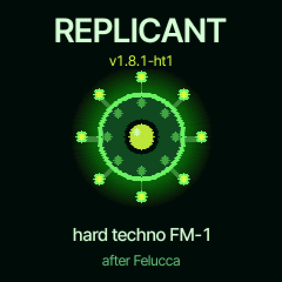
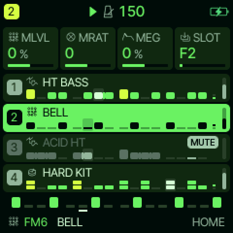
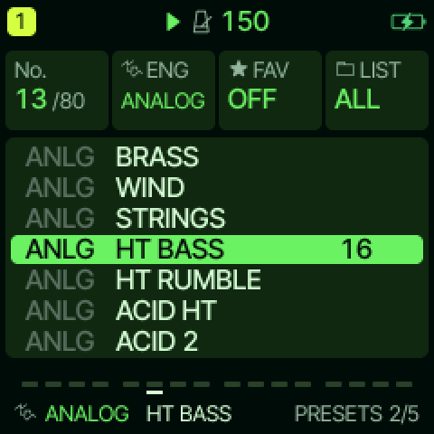
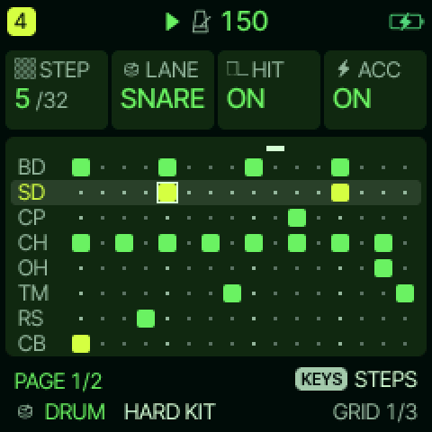
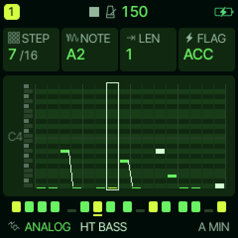
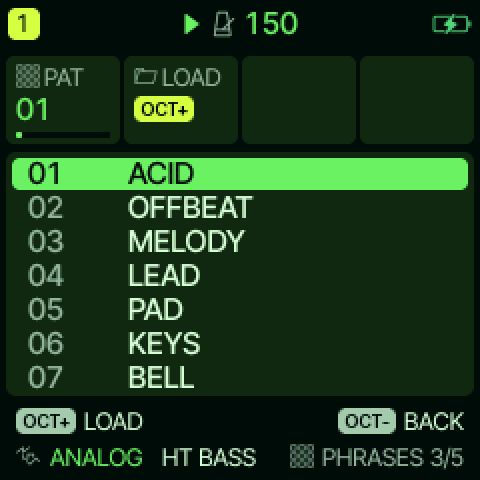
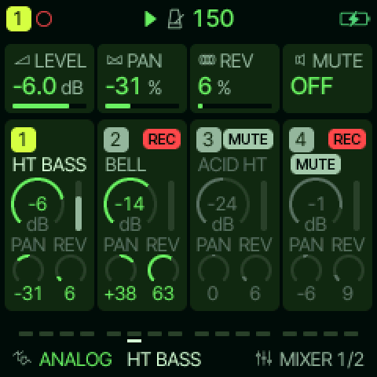
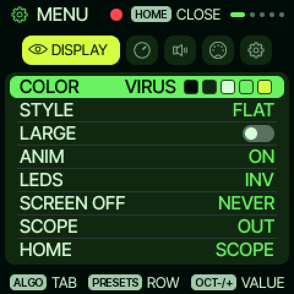
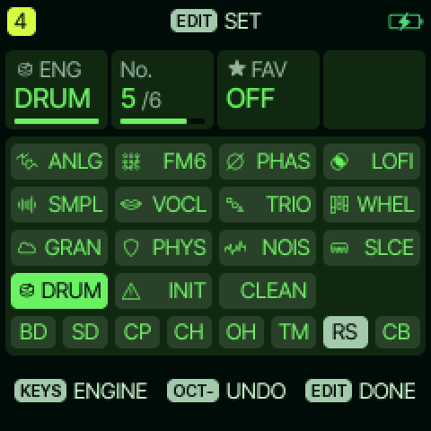

# ReplicantFM1

**Hard techno firmware for the M-VAVE FM-1.**

[](LICENSE)
[](https://www.m-vave.com/product?id=fm-1)

ReplicantFM1 turns the FM-1 into a four-track hard techno instrument: a kick that carries on a phone speaker,
drums and hi-hats, a driven bass and rumble, 303-style acid lines and offbeat stabs — with per-sound drive,
glide and insert effects, on top of everything the FM-1 already does.

It is custom open-source firmware, a fork of [Felucca](https://github.com/hugelton/Felucca) 1.8.1 by Leo
Kuroshita / Hügelton Instruments (GPL-3.0-only). The fork keeps Felucca's engines, sequencer, effects and
browser editor intact and adds a sound bank, six patterns and a techno boot state. Nothing was removed, and no
stored format changed: projects, presets, samples and MIDI setups made on Felucca load as they are.

## The synthesizer

The FM-1 is a small desktop groovebox: four tracks, 16 keys plus function keys, four knobs, a 240×240
screen and USB (MIDI in/out and class-compliant stereo audio). ReplicantFM1 gives it:

| | |
| --- | --- |
| **Tracks** | 3 synth tracks (8 voices shared) + 1 drum track (16 sounds, 6 voices) |
| **Engines** | 13, including ANALOG (2 osc + noise + state-variable filter), FM6 (6-operator FM with DX7 patches), PHYS, GRAIN, SAMPLE, NOISE and the DRUM kit engine |
| **Sequencer** | 64 steps per track, its own length and division each, swing, ties, slides, ratchets, per-step chance and parameter locks |
| **Drums** | 16 sounds per kit, all synthesised in this firmware — kick, snare, clap, closed/open hats, tom, rim, cymbal, bell |
| **Effects** | per-track DIST / CHORUS / DELAY / REVERB sends and an INSERT (drive, fold, fuzz, crush, phaser, flanger, chorus); 27 punch-in FX on the keys; master limiter |
| **Performance** | song sections A–D with a quick chain, fills, live mutes, arpeggiator, chord keys, visualiser |
| **Audio** | 44.1 kHz, USB audio out (record straight into a DAW or a phone) |

### The hard techno sound bank

Everything below is new in this fork and sits alongside Felucca's own 153 sounds.

**Drums — two kits** (`KIT` on the drum track, after `PERC`):

- **`HARD`** — an F#1 kick (46 Hz) that starts about 18 semitones up, holds 7 ms and drops in 20 ms with a
  2 kHz click, ×1.7 into the voice's soft clip; a bright 185 Hz snare; a dry 4-tooth clap; 10 ms closed and
  73 ms open hats; a 96 Hz tom; a 1.2 kHz rimshot; a metal cymbal.
- **`INDUS`** — lower and longer: a 44 Hz kick with more drive, a ringing snare, a 6-tooth gated clap, noisier
  hats, a lower tom, a clave-like rim, a wider metal bell.

Both are synthesised — no sample slots are used, so your own samples (USR1–USR4) stay free. Lane levels match
Felucca's own kit within ±1.5 dB, so swapping kits keeps the mix.

**Synths — seven `ANALOG` presets:**

| Preset | What it is |
| --- | --- |
| `HT BASS` | driven saw bass, dark filter, `HARD` insert, drive send up — sits under the kick |
| `HT RUMBLE` | SUB wave (OSC 2 an octave down), no resonance: the low end under the kick |
| `HT SUB` | a bare sine for the very bottom of the mix |
| `ACID HT` | the 303: saw, resonance 124, a short decay to nothing, filter envelope, long glide |
| `ACID 2` | the same on a square, brighter and meaner |
| `HT STAB` | two detuned saws, resonant, short, polyphonic: the offbeat stab |
| `HT SCREAM` | WAVE SYNC, OSC 2 an octave above, long glide: the screaming lead |

Each one carries its own `GLIDE` and `INSERT` (from `firmware/src/ht_flavor.c`), so a preset load restores the
whole sound and not just the knobs.

**Patterns** (`SEQ` → `PATTERNS`): `HT KICK` (four to the floor with an offbeat open hat and a rim), `HT ACID`
(a 303 line with slides), `HT BASS` (offbeat rumble), `HT STAB` (offbeat chords), `HT ROLL` (snare, rim and tom
rolls into the kick).

### It boots as a set

| Track | Sound | Role |
| --- | --- | --- |
| T1 | `HT BASS` | bass |
| T2 | `BELL` (FM6) | metallic stab, fast enough to open on a 1/16 |
| T3 | `ACID HT` | acid line |
| T4 | `HARD KIT` | drums |

150 BPM, straight, delay and room at techno settings. The sequencers start **empty**, exactly as Felucca ships:
press `PLAY` and nothing sounds until you load patterns, so the first thing you hear is what you played.

### The look

It also boots in `VIRUS`, the fork's own palette: a near-black green ground, phosphor green for values, curves and
selections, acid lime for the one active thing. It is appended as the eleventh palette, so every saved palette id
still opens the same palette it did on Felucca; `MENU` → `DISPLAY` → `COLOR` (or the editor) picks any of the
eleven. The power-on splash is drawn in the same five colours: a virus particle with an acid nucleus, the name and
version above it, `hard techno FM-1` and the lineage below.

## The panel in pictures

These are captures of the firmware's own drawing code, rendered by the test suite at 240×240 and doubled here
(`docs/screens/`, the default `VIRUS` palette). Nothing is a mock-up.

<table>
<tr>
<td align="center"><br><sub><b>Power-on.</b> The splash, version <code>v1.8.1-ht1</code>.</sub></td>
<td align="center"><br><sub><b>HOME → TRACKS.</b> The four boot sounds; the knobs show the selected track.</sub></td>
</tr>
<tr>
<td align="center"><br><sub><b>PRESETS.</b> The bank, with the new <code>HT BASS</code>, <code>HT RUMBLE</code>, <code>ACID HT</code>, <code>ACID 2</code>.</sub></td>
<td align="center"><br><sub><b>DRUMS.</b> The 8 lanes of <code>HARD KIT</code>; <code>STEP</code> / <code>LANE</code> / <code>HIT</code> / <code>ACC</code> on the knobs.</sub></td>
</tr>
<tr>
<td align="center"><br><sub><b>STEP.</b> A bass line as a piano roll, one note and its flag per step.</sub></td>
<td align="center"><br><sub><b>PATTERNS.</b> Where the six new <code>HT …</code> patterns load from.</sub></td>
</tr>
<tr>
<td align="center"><br><sub><b>MIXER.</b> Level, pan and reverb send per track — the balance of the set.</sub></td>
<td align="center"><br><sub><b>MENU.</b> Display, audio, MIDI and system settings.</sub></td>
</tr>
<tr>
<td align="center" colspan="2"><br><sub><b>EDIT layer.</b> Held <kbd>EDIT</kbd>: engine per key, <code>INIT</code> / <code>CLEAN</code>, and the drum lanes' mutes (<code>BD SD CP CH OH TM RS CB</code>).</sub></td>
</tr>
</table>

## How to use it

The FM-1 is played live: **hold a button and the keys and the four knobs change job**. The screen always says
what a key or knob does right now. Tap a button instead of holding it and its pages open.

### Get the set going (60 seconds)

1. Press **`SEQ`**, then the **`PATTERNS`** page (`AT` / `LOAD`). Load `HT KICK` onto the drum track — T4.
2. `OCT−` back, `1`–`4` select the track, and load `HT BASS` on T1, `HT STAB` on T2, `HT ACID` on T3.
3. Press **`PLAY`**. Everything runs in sync from one clock.
4. Swap `HT ROLL` onto the drums for a fill, then `HT KICK` back.

### The four tracks

- **Knobs on HOME** are the selected track's four main parameters (for `ACID HT`: cutoff, resonance, attack,
   release). Hold a layer button and the knobs switch to that layer's parameters.
- **`EDIT`** held gives the sound's own pages (engine, oscillator, filter, envelope, insert, modulation).
- **`SEQ`** held gives the step editor: notes, velocity, length, ratchets, chance, slides, and per-step
  parameter locks.
- **`MIXER`** gives level, pan, reverb/delay sends and mute per track.
- **`FX`** held turns the keys into 27 punch-in effects (filter kill, rewind, flanger, freeze, and more).

### Acid

Load `ACID HT` on T3, then hold **`SEQ`** and write a line with slides (`SLIDE` on a step glides into the next
note — the preset's glide time makes it a 303). Turn **CUT** and **RES** live with the knobs; `EDIT` → `ENV
DEST` sets how far the envelope sweeps the filter. `ACID 2` is the same voice on a square, and `HT SCREAM` is
the sync-sweep lead for the build-ups.

### Drums

The drum track maps its 8 lanes to the keyboard (`BD SD CP CH OH TM RS CB`). Hold **`EDIT`** to mute lanes live;
the grid page writes patterns step by step (`STEP`, `LANE`, `HIT`, `ACC`), and `EDIT` → `KIT` / `TUNE` /
`TONE` / `DECY` / `SNAP` / `DRV` reshape the whole kit at once. `DRV` is the whole kit's drive — on `INDUS`
it is already open.

### Sequencing, song and saving

- Each track has its own length (1–64 steps), division and swing: polymeter and polyrhythm come for free.
- Song sections A–D (`SAVE` layer) chain patterns; hold `SAVE` and tap a section sequence to chain them live.
- `SAVE` held also **undoes** the last sound or pattern load.
- Save with `SAVE` → `PROJECT`; the FM-1 keeps one song in RAM plus project slots, and the browser editor can
  back up everything as one file.

### MIDI and audio

USB MIDI in/out and TRS MIDI in on the 3.5 mm jack (adapter), with MIDI clock in and out; the sequencer can be
sent to MIDI out to drive another synth. The FM-1 is also a USB audio interface: record the master output
straight into a DAW or a phone.

## How to load the firmware

The package is **`ReplicantFM1-1.8.1-ht1.fwsc`** in the root of this repository (also produced by the build as
`build/felucca.fwsc`). Flashing custom firmware is at your own risk; a cut-off update is recoverable with USB
RESCUE (hold `OCT−` at power-on) and the same installer.

**0. Back up the FM-1 first.** Open the browser editor, connect the device and use its backup page: it saves
projects, presets, user samples and settings in one file. An update keeps the sound data, but a backup is what
saves you if an experiment goes wrong.

**1. Connect the FM-1 by USB.** It shows up as a MIDI device (and an audio interface). The running firmware
only needs to speak its update protocol, which both installers handle.

**2a. Command line (Linux/macOS/Windows):**

```sh
pip install mido python-rtmidi
python3 tools/fm1_install.py ReplicantFM1-1.8.1-ht1.fwsc
```

The installer answers the device's own read requests, hands over the update loader, writes the package,
restarts the FM-1 and checks the installed identity. It exits non-zero on a missing device (`3`), a lost
connection (`4`) or a timeout (`5`) rather than leaving you guessing; `--info` lists what it sees without
writing anything.

**2b. Browser installer (Chrome or Edge on a desktop):**

```sh
python3 web/make_site.py ReplicantFM1-1.8.1-ht1.fwsc 1.8.1-ht1 out-site
python3 -m http.server -d out-site 8000
```

Then open <http://localhost:8000/webapp/installer/> and press *Install*. `web/make_site.py` also emits the full
browser editor next to it, so the same page can back up the device, edit sounds and sequences and send them
back.

**3. Check it took.** The splash on power-on reads `Replicant`, and `MENU` → `ABOUT` shows `v1.8.1-ht1`.

**Going back.** Use M-VAVE's **M-UPGRADE** with the official V16 image (or Felucca's own package) the same way;
the update replaces the app and leaves projects, presets and samples alone.

## Build from source

Needs the JieLi `pi32v2` toolchain, three files from the JieLi AC79 SDK, and Python with Pillow and fontTools:

```sh
tools/get_toolchain.sh                       # downloads the toolchain to ~/.jieli (~25 MB)
git clone --depth 1 --branch AC79NN_SDK_V1.2.1_2023-12-13 \
    https://gitee.com/Jieli-Tech/fw-AC79_AIoT_SDK.git ~/fw-AC79_AIoT_SDK
./build.sh                                   # -> build/felucca.bin, build/loader/ota.bin, build/felucca.fwsc
```

The tree carries `firmware/engines` (Felucca-Engines, MIT) and `firmware/bsp` (felucca-bsp, MPL-2.0) vendored at
the pinned commits, so no submodule step is needed. More detail in [BUILDING.md](BUILDING.md).

Tests run on the host, no hardware needed:

```sh
AC79_SDK=~/fw-AC79_AIoT_SDK JIELI_TOOLCHAIN=~/.jieli/toolchain sh tests/run_tests.sh
```

They cover the engines against golden renders, the sequencer timing, the drum voices against measured
targets, the UI layout (every screen in every palette), flash storage, MIDI, USB audio, the installer protocol
and the browser editor. The suite ends with `ALL HOST TESTS PASSED`.

### Listen without hardware

`ht-tools/` renders and measures sounds through the same DSP sources the firmware uses:

```sh
./ht-tools/preview.sh out.wav          # the boot set, 8 bars at 150 BPM (SOLO=1..4 for one track)
./ht-tools/hostsim.sh                  # the renderer the analysis tools drive
python3 ht-tools/analyze.py 10 4 --steps 36,0,0,0,0,0,0,0,0   # peak, RMS, decay, band split
python3 ht-tools/plot.py 10 4 /tmp/kick.png --steps 36,0,0,0,0,0,0,0   # spectrogram + waveform
```

## Re-voice it

- **Kits:** `firmware/src/drum_voice.c`, the last two rows of `DV_KIT` (the `HARD` and `INDUS` entries). Each
  lane is Felucca's drum voice with its own numbers, and the comment above the table explains every value.
  `tests/drum_test.c` holds the measured targets; `KTGT=1 build/drum_test` prints fresh ones after a change.
- **Synth presets:** `firmware/engines/src/eng_analog.c`, `ANALOG_PRESETS[]` (the seven at the end), plus
  `firmware/src/ht_flavor.c` for their glide and insert, and the `ANALOG` table in `web/editor.html` so the
  browser editor agrees.
- **Patterns and boot sounds:** `firmware/src/engines.c` (`PATTERNS[]`, `TRK_DEF`); boot tempo in
  `firmware/src/main.c`.
- After an intended change of the sound, `GOLDEN_UPDATE=1 sh tests/run_tests.sh` rewrites the golden renders —
  review the diff, it should be the rows you meant to move.

## What this fork changes

All additive:

- `firmware/src/drum_voice.c`, `firmware/src/eng_drum.c`: kits `HARD` (12) and `INDUS` (13), presets `HARD KIT`
  and `INDUS KIT`.
- `firmware/engines/src/eng_analog.c`: seven presets after `STRINGS`.
- `firmware/src/ht_flavor.c` (new): per-preset `GLIDE` and `INSERT`, applied by `ui.c apply_preset_to`.
- `firmware/src/engines.c`: six patterns and the boot `TRK_DEF`.
- `firmware/src/main.c`: boot tempo 150 (parameter defaults and every FX bus stay Felucca's).
- `firmware/src/category.c`, `web/editor.html`, `web/test_web.mjs`: the new sounds in the PRESETS categories and
  in the browser editor.
- Branding: the splash, `MENU` → `ABOUT`, and the version string.
- Tests: content assertions and the song / golden baselines moved with the new bank, each one saying why.
- `docs/screens/`: the captures above, regenerated by `tests/ui_render.c` + `tests/ui_render.py`.

## Credits and licence

- **Felucca** by Leo Kuroshita ([@kurogedelic](https://github.com/kurogedelic)) / Hügelton Instruments — the
  engines, the sequencer, the UI, the editor, the installer, and the drum voice these kits are built on.
  GPL-3.0-only.
- **Felucca-Engines** (MIT), **felucca-bsp** (MPL-2.0) and, inside the package, JieLi AC79 SDK files
  (Apache-2.0): see [LICENSING.md](LICENSING.md) and [LICENSES/](LICENSES/).
- The ReplicantFM1 fork is GPL-3.0-only, like the project it comes from.

M-VAVE and FM-1 are trademarks of their respective owners. This is an independent fork, not affiliated with,
endorsed by or supported by M-VAVE or by the Felucca maintainer: report its bugs here, not upstream.
