# ReplicantFM1

**ReplicantFM1** turns the M-VAVE FM-1 into an acid, techno, and big-beat groovebox: an authentic **TR-909** drum machine, a modelled **Roland SH-101** monophonic synthesizer, dual **TB-303** acid basslines (303A & 303B) powered by the **TB-3PO** generative algorithm, and a real-time sliced **breakbeat player**, all performing simultaneously in stereo.

Each part can run its own independent step length (up to 64 steps), clock rate, and polymetric drift. You can arrange patterns into full songs, automate and record knob motions live or step-by-step (parameter locking), and give every single step probability and condition cycles. The mix runs through a shared stereo reverb, tape ping-pong delay, and a master bus featuring tube drive, resonant filter, and a sidechain **Master Pump** compressor driven by the 909 kick.

Over USB, the FM-1 acts as a class-compliant MIDI controller/interface and a 24-bit stereo audio interface with no drivers required.

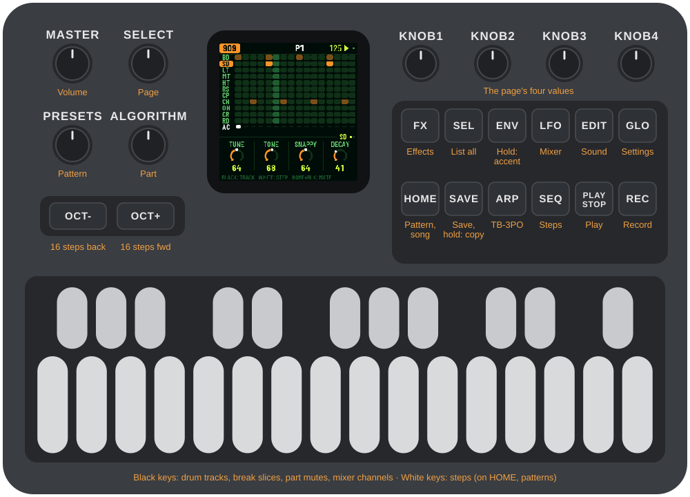

---

## Screen Gallery

| Home Overview | Roland SH-101 VCO |
|---|---|
| 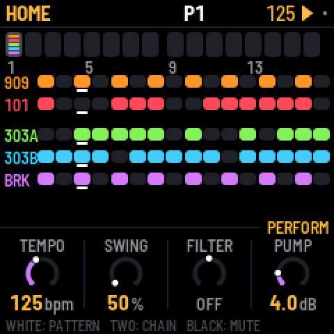 | 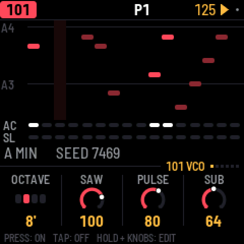 |
| **Roland SH-101 VCF** | **Roland SH-101 Sequencer** |
| 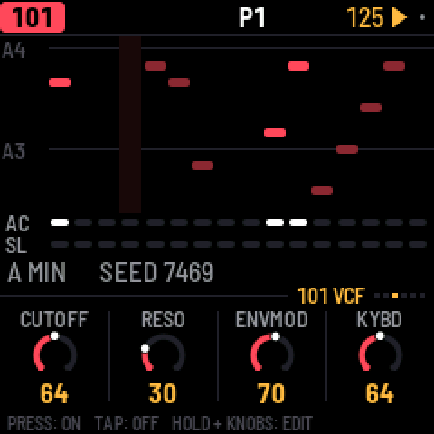 | 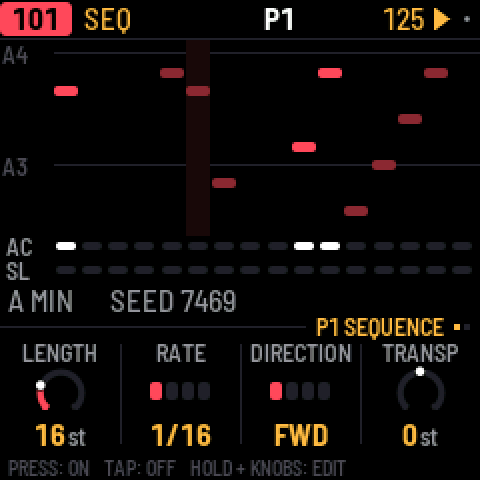 |
| **TR-909 Drum Grid** | **TB-303 Acid Bassline** |
| 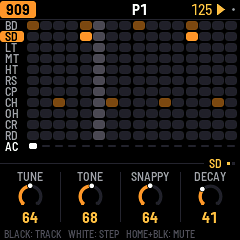 | 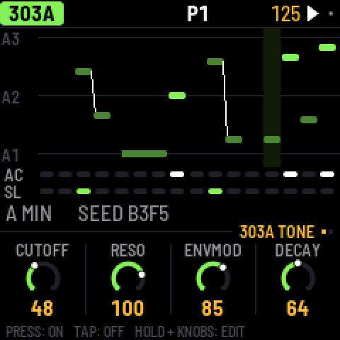 |
| **TB-3PO Algorithmic Generator** | **Breakbeat Slicer** |
| 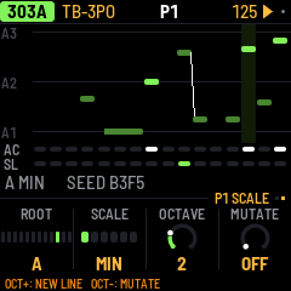 | 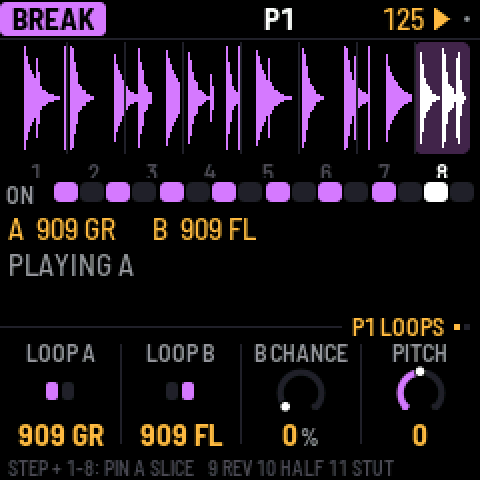 |
| **Master Bus & Compressor Pump** | **Stereo Reverb & Tape Delay** |
| 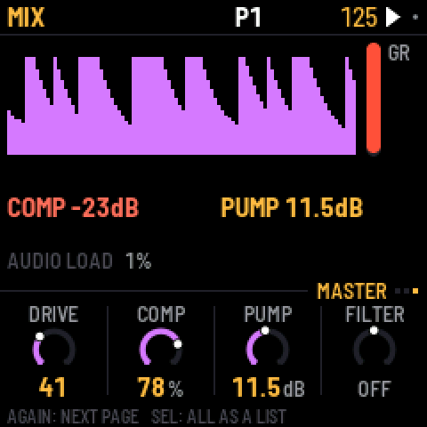 | 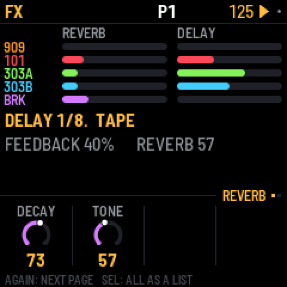 |

---

## What's Inside

| Part | Description | Engine Details |
|---|---|---|
| **TR-909** | 11 drum voices: modelled analog kick, snare, toms (low/mid/high), rimshot, and clap, with 6-bit sampled hats, crash, and ride. | Based on [9W9](https://github.com/athousanddetails/schwung-9W9) (samples from ER-99). |
| **Roland SH-101** | Full analog monophonic synthesizer: CEM3340 VCO (Saw, Pulse/PWM, Sub-osc, Noise), IR3109 4-pole ZDF low-pass resonant filter, snappy ADSR envelope, multi-waveform LFO, VCA ENV/GATE switch, portamento glide, accent, overdrive, and stereo pan. | Custom DSP implementation for ReplicantFM1. |
| **TB-303 A & B** | Two independent Open303 engines with Devilfish extensions, each with its own sound and pattern, supported by the TB-3PO generative line algorithm. | Based on [schwung-303](https://github.com/charlesvestal/schwung-303) & [schwung-tb3po](https://github.com/charlesvestal/schwung-tb3po). |
| **Breakbeat Player** | Real-time 8-slice loop slicer and rearranger with pitch shifting, resonant multimode filtering, retriggers, fills, and reverse playback. | Based on [BB Gen](https://github.com/mestela/schwung-breakbeat). |
| **Master FX & Bus** | Stereo algorithmic reverb, tempo-synced ping-pong tape delay with saturation, master overdrive, resonant filter, and Master Pump sidechain compressor. | luchak reverb, 12-bit/tape delay, and custom pump compressor. |

---

## Roland SH-101 Synthesizer Engine

The Roland SH-101 implementation in ReplicantFM1 recreates the architecture and sound of the classic 1982 analog monosynth:

- **CEM3340 Voltage Controlled Oscillator (VCO)**:
  - Selectable Octave range: `16'`, `8'`, `4'`, `2'`.
  - Simultaneous mixing of Sawtooth, Pulse / PWM, Sub-oscillator, and Noise.
  - Sub-Oscillator types: `-1 Octave Square`, `-2 Octaves Square`, `-2 Octaves Narrow Pulse`.
  - Pulse Width (PW) adjustable manually (50% square down to narrow pulse) or modulated via PWM.
  - PWM Modulation sources: Manual (`MAN`), LFO (`LFO`), or Envelope (`ENV`), with variable PWM Amount.
  - White / pink analog noise generator.
- **IR3109 4-Pole (24 dB/oct) Low-Pass Resonant Filter (VCF)**:
  - Zero-Delay Feedback (ZDF) ladder topology with non-linear saturation.
  - Full self-oscillation into a pure sine wave at high resonance settings.
  - Envelope Modulation (`ENVMOD`) with fast bipolar impact on cutoff.
  - Keyboard Pitch Tracking (`KYBD`) adjustable from 0% to 100%.
  - Dedicated LFO filter modulation depth (`VCF MOD`).
- **Snappy Roland ADSR Envelope**:
  - Analog-modeled exponential Attack, Decay, Sustain, and Release curves.
- **Low Frequency Oscillator (LFO)**:
  - Continuous rate control from sub-audio clicks to rapid modulation.
  - 4 selectable waveforms: Triangle (`TRI`), Square (`SQR`), Random Sample & Hold (`RND`), and Noise (`NOI`).
- **Amplifier (VCA) & Performance**:
  - VCA Mode switch: `ENV` (shaped by the ADSR envelope) or `GATE` (instant organ gate on key presses).
  - Portamento Glide: Adjustable glide rate, with Glide Mode set to `AUTO` (legato slide on overlapping notes), `ON` (glide every note), or `OFF`.
  - Accent: High-velocity or sequenced accents boost filter cutoff and amplifier punch.
  - Overdrive: Dedicated analog tube-style drive on the synth voice output.
  - Fine tuning (±100 cents) and stereo pan position.
- **Sequencer Integration**:
  - 64-step piano roll with note pitch, gate, slide, and accent locks.
  - Real-time keyboard recording across all 27 keys (`REC`).
  - Algorithmic generation via **TB-3PO** (`ARP`).

---

## Hardware Dual-Core Distribution

ReplicantFM1 utilizes both processor cores of the JieLi AC79 series chip to achieve dropout-free audio at 44.1 kHz:

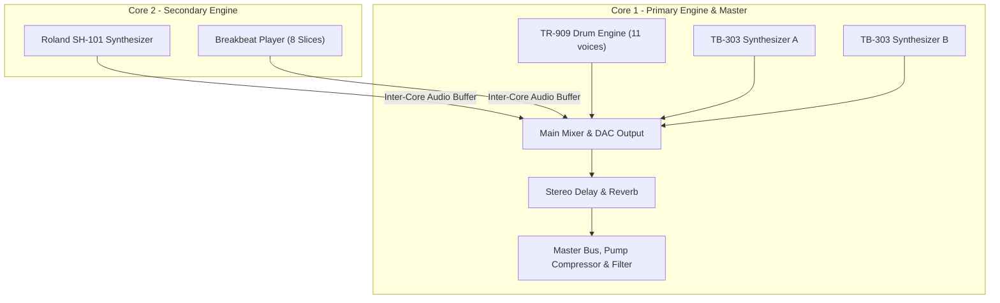

This load balancing maintains CPU consumption under 70% per core even during heavy 64-step polymetric patterns with full effects and compressor pump active.

---

## MIDI Implementation

ReplicantFM1 responds to external MIDI over USB and TRS MIDI IN:

| MIDI Channel | Instrument / Destination | Behavior |
|---|---|---|
| **Channel 1** | **Roland SH-101** | Melodic notes. Velocity &ge; 100 triggers accent. Overlapping notes trigger legato slide. |
| **Channel 2** | **TB-303 A** | Melodic notes. Velocity &ge; 100 triggers accent. Overlapping notes trigger legato slide. |
| **Channel 3** | **TB-303 B** | Melodic notes. Velocity &ge; 100 triggers accent. Overlapping notes trigger legato slide. |
| **Channel 4** | **Breakbeat Player** | Notes 36–43 fire slices 1–8. |
| **Channel 10** | **TR-909 Drums** | General MIDI drum notes: 36 BD, 38 SD, 41 LT, 45 MT, 50 HT, 37 RS, 39 CP, 42 CH, 46 OH, 49 CR, 51 RD. |

### Roland SH-101 MIDI CC Map (Channel 1)

| CC | Parameter | CC | Parameter |
|---|---|---|---|
| **74** | VCF Cutoff | **85** | VCO Octave |
| **71** | VCF Resonance | **86** | PWM Source (MAN / LFO / ENV) |
| **77** | VCF Env Mod | **87** | Pulse Width (PW) |
| **90** | Keyboard Tracking (KYBD) | **88** | PWM Amount |
| **14** | VCF LFO Mod | **15** | VCA Mode (ENV / GATE) |
| **81** | Saw Level | **76** | LFO Rate |
| **80** | Pulse Level | **28** | LFO Wave (TRI / SQR / RND / NOI) |
| **82** | Sub-Osc Level | **5** | Glide / Portamento Time |
| **84** | Sub-Osc Type | **65** | Glide Mode (AUTO / ON / OFF) |
| **83** | Noise Level | **29** | Accent Depth |
| **73** | Envelope Attack | **78** | Overdrive |
| **75** | Envelope Decay | **31** | Voice Volume |
| **79** | Envelope Sustain | **30** | Master Tune |
| **72** | Envelope Release | **10** | Stereo Pan |
| **7** | Channel Level | **91 / 93** | Reverb Send / Delay Send |

### Master Bus & FX MIDI CC Map (Mix Channel)

| CC | Destination |
|---|---|
| **16** | Master Drive |
| **17** | Master Compressor (Threshold / Ratio) |
| **18** | Master Sidechain Pump Depth |
| **19** | Master Filter Cutoff (Low-pass &larr; Center Off &rarr; High-pass) |
| **71** | Master Filter Resonance |
| **20 / 21** | Reverb Decay / Tone |
| **22–25** | Delay Time / Feedback / Tone / Tape Saturation |
| **102–106** | Part Volumes: 909, 101, 303A, 303B, Break |

---

## Front Panel Keymap

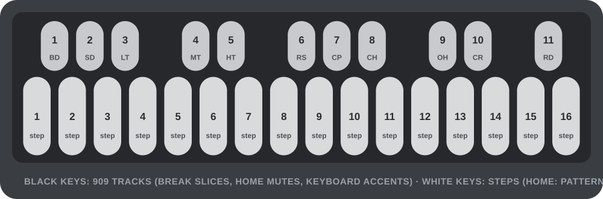

- **White Keys (1–16)**: Sequencer step triggers (1–16, 17–32, 33–48, 49–64 via `OCT-`/`OCT+`). On `HOME`, selects Patterns 1–16. On synths (`REC` active), functions as keyboard piano keys.
- **Black Keys (1–11)**: TR-909 voice selection (`BD` to `RD`). On `BREAK`, triggers slices 1–8. On `HOME`, toggles Part Mutes. On synths (`REC` active), functions as sharp/flat piano keys.

---

## Building and Verification

ReplicantFM1 includes a comprehensive offline test harness and simulator (`host/x0x_host`) verifying DSP math, sequencer logic, MIDI parsing, and flash persistence:

```bash
# Run the complete test suite and scenario regressions
tests/run_tests.sh

# Build the device firmware package (requires JieLi toolchain and AC79 SDK)
./build.sh
```

### Build Artifacts
- `build/x0x.bin`: Binary application image for the FM-1.
- `build/x0x.fwsc`: Encrypted update package compatible with the web installer and bootloader.

---

## Installing Firmware

1. Connect the M-VAVE FM-1 to your computer using a USB-C data cable.
2. Open the web installer: `web/x0x_installer.html` in Chrome, Edge, or Opera (WebUSB enabled).
3. Select your device and choose `build/x0x.fwsc`.
4. Click **Install**. The FM-1 will flash the image and restart into ReplicantFM1.

---

## Credits & Licensing

- **ReplicantFM1**: GPL-3.0-only.
- **Roland SH-101 Engine**: Custom physical-modelling DSP engine (CEM3340 VCO + IR3109 4-pole ZDF VCF).
- **TR-909 Drum Engine**: Ported from [9W9](https://github.com/athousanddetails/schwung-9W9) by athousanddetails (ER-99 samples by Matthew Cieplak, GPL-3.0).
- **Open303**: Robin Schmidt (MIT licence) with devilfish extensions from schwung-303.
- **TB-3PO**: Generative line generator from [schwung-tb3po](https://github.com/charlesvestal/schwung-tb3po).
- **Breakbeat Engine**: Ported from BB Gen by mestela.
- **Platform & Hardware Abstraction**: Derived from [Felucca](https://github.com/hugelton/Felucca) by Leo Kuroshita (Hügelton Instruments).
- **Dual-Core Boot Architecture**: Based on research by [Melodee](https://github.com/keremimo/melodee) (keremimo) and [Jangada](https://github.com/zednaked/jangada) (zednaked).
- **Fonts**: Barlow Semi Condensed and Terminus (SIL Open Font License 1.1).

*TR-909, SH-101, and TB-303 are trademarks of Roland Corporation. M-VAVE and FM-1 are trademarks of their respective owners. ReplicantFM1 is an independent open-source project and is not affiliated with or endorsed by Roland or M-VAVE.*
